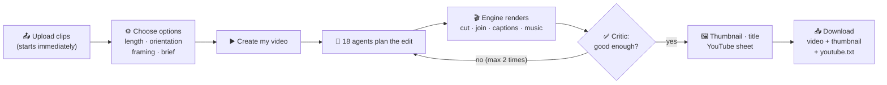
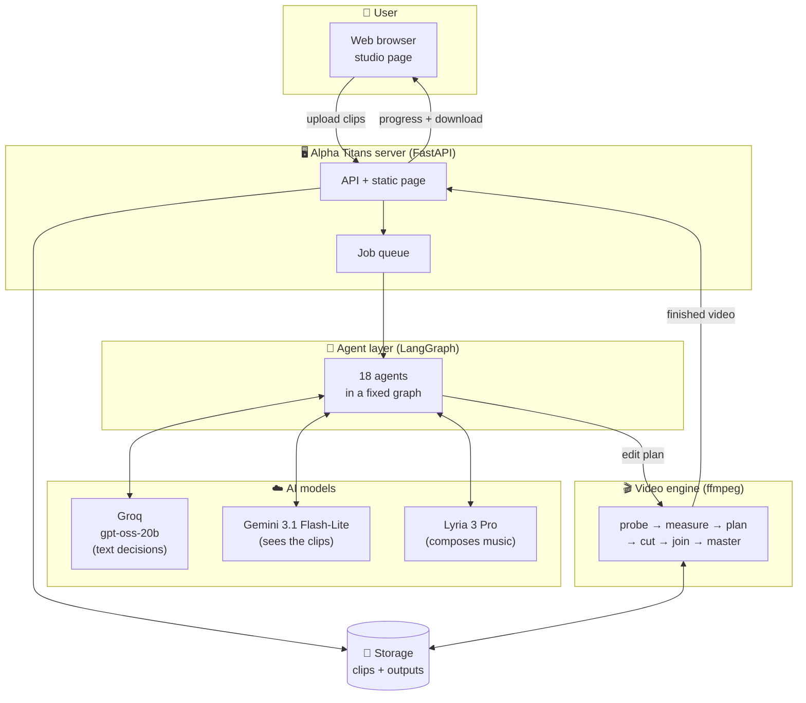
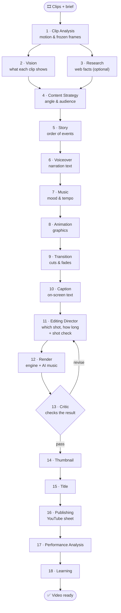
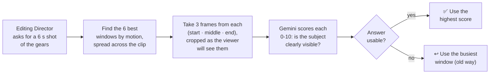
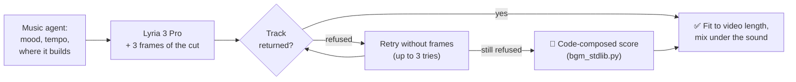
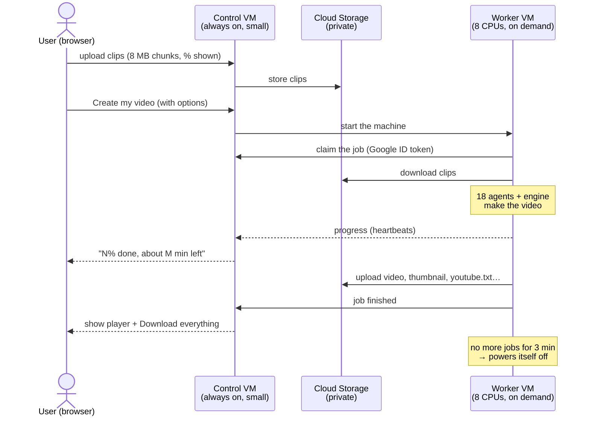

<div align="center">

# 🎬 Alpha Titans

### An AI video editor: raw footage in, a YouTube-ready video out.

Upload your clips and say what the video is about. A team of **18 AI agents**
plans the edit, picks the best shots, writes captions, composes music and
checks the result. You get a finished video, a thumbnail and a YouTube upload
sheet.

`Python` · `FastAPI` · `LangGraph` · `ffmpeg` · `Groq` · `Gemini` · `Lyria` · `Google Cloud`

</div>

---

## 📌 Contents

1. [What is Alpha Titans?](#-what-is-alpha-titans)
2. [What it does](#-what-it-does)
3. [How it works, from upload to download](#-how-it-works-from-upload-to-download)
4. [System architecture](#-system-architecture)
5. [The 18 agents](#-the-18-agents)
6. [How a shot is chosen](#-how-a-shot-is-chosen)
7. [How the music is made](#-how-the-music-is-made)
8. [The cloud studio](#-the-cloud-studio)
9. [Tech stack and AI models](#-tech-stack-and-ai-models)
10. [Project structure](#-project-structure)
11. [Getting started](#-getting-started)
12. [Settings](#-settings)
13. [Tests](#-tests)
14. [Deployment and costs](#-deployment-and-costs)
15. [Current limits and roadmap](#-current-limits-and-roadmap)
16. [Documentation](#-documentation)

---

## 🎯 What is Alpha Titans?

**The problem.** Making a good YouTube video from raw footage takes hours. A
creator who films a build, a tutorial or a project often has many minutes of
clips. Most of that footage is hands, empty table or blur. Someone has to
watch all of it, choose the good moments, put them in an order that tells a
story, add captions and music, balance the sound and export it correctly.

**The solution.** Alpha Titans does that editing work automatically. It works
like a small editing team, where each AI agent has one job:

- a **strategist** decides the angle of the video;
- a **story writer** decides the order;
- an **editing director** chooses which seconds of which clip to use;
- a **music agent** directs the soundtrack;
- a **critic** checks the result and can send the edit back for another pass;
- and so on, for **18 agents** in total.

A video engine built on ffmpeg then renders the final cut.

**What it is not.** Alpha Titans never uploads to YouTube. It prepares
everything for upload, and publishing stays your decision.

---

## ✨ What it does

| | Feature | What it means for you |
|---|---|---|
| 🎞️ | **Automatic editing** | Finds the strongest moments across all your clips and cuts them into one story. |
| 👁️ | **Shot check** | A vision model looks at candidate shots and rejects ones that are mostly hands, blur or empty table. |
| 🎵 | **AI-composed music** | Google's Lyria writes an original track to fit the length and mood of your cut. |
| 💬 | **Captions** | Writes on-screen captions that match what each shot shows. |
| 📐 | **Any format** | Horizontal (16:9) for YouTube or vertical (9:16) for Shorts. Mixed clips are shown whole on a blurred background. |
| 🔊 | **Mastered sound** | Normalises loudness to a standard streaming level (-16 LUFS), so the video is never too quiet or too loud. |
| ✅ | **Self-checking** | A critic checks length, frames, sound and opening, and can ask for a revision (up to 2 times). |
| 🖼️ | **Thumbnail and title** | Picks a thumbnail frame and writes a title, description and tags. |
| ☁️ | **Cloud studio** | Runs in the browser with no install and no sign-in. Rendering happens on a cloud machine that switches itself off when done. |
| 📊 | **Live progress** | Shows the upload percentage, then "N% done, about M minutes left" while the video is being made. |

---

## 🔄 How it works, from upload to download



**What you get at the end:**

| File | What it is |
|---|---|
| 🎬 video (`.mp4`) | the finished video |
| 🖼️ thumbnail (`.jpg`) | the thumbnail |
| `youtube.txt` | title, description and tags, ready to paste into YouTube |
| `edit_plan.json` | every editing decision and the reason for it |
| `output.json`, `run.log` | technical report of the run |

---

## 🏗️ System architecture



**The two main layers:**

- **The agent layer decides.** It works out what to show, in which order, for
  how long, with which captions and which music.
- **The engine executes.** It is a deterministic ffmpeg pipeline
  (`pipeline/build_video.py`) that turns the plan into a video, measures it
  and verifies it.

Keeping the two layers separate makes every decision explainable: each one is
recorded in `edit_plan.json` with its reason.

---

## 🤖 The 18 agents



| # | Agent | Job | Model |
|---|---|---|---|
| 1 | Clip Analysis | Measures where each clip moves, freezes or goes still. | ffmpeg |
| 2 | Vision | Describes what each clip shows. | Gemini |
| 3 | Research | Looks up facts on the web (only if a search key is set). | Tavily / Brave |
| 4 | Content Strategy | Decides the angle, audience and tone. | Groq |
| 5 | Story | Puts the moments in an order that tells a story. | Groq |
| 6 | Voiceover | Writes narration text. | Groq |
| 7 | Music | Decides mood, tempo and where the music builds. | Groq |
| 8 | Animation | Decides on graphics (stock graphics off by default). | Groq |
| 9 | Transition | Chooses cuts and fades. | Groq |
| 10 | Caption | Writes on-screen captions. | Groq |
| 11 | Editing Director | Chooses the clip, the seconds and the length of every shot, then runs **shot check**. | Groq + Gemini |
| 12 | Render | Runs the engine and gets the music composed. | ffmpeg + Lyria |
| 13 | Critic | Checks length, frames, loudness and the first 3 seconds; sends the edit back if needed. | code |
| 14 | Thumbnail | Picks and prepares the thumbnail. | Groq |
| 15 | Title | Writes the title (if you did not give one). | Groq |
| 16 | Publishing | Checks YouTube's limits and writes `youtube.txt`. Never uploads. | code |
| 17 | Performance Analysis | Reads how published videos performed. | code |
| 18 | Learning | Improves future decisions from that performance data. | code |

> **No model, no problem.** If a model is down or not configured, each agent
> falls back to a rule-based path and marks its result `degraded`. The video
> still gets made.

---

## 🔍 How a shot is chosen

The busiest part of a hands-on clip is often a hand passing in front of the
lens. Choosing shots by motion alone therefore produced videos full of
forearms. **Shot check** fixes this:



The model only **ranks** windows that the pipeline itself found. It never
invents a moment.

---

## 🎵 How the music is made



Lyria turns down about 1 request in 4 at random, so there is always a
fallback. Every video gets music.

---

## ☁️ The cloud studio

The cloud version runs in any browser, with no install and no sign-in. A
small, always-on machine takes uploads. A powerful machine starts only when
there is a video to make, and switches itself off afterwards.



**Safety and fairness:**

- **Jobs are private by key.** Each job has a random 48-bit id, and your
  browser keeps the list of your own jobs. Nobody else can see them.
- **Daily limit.** At most 20 new videos are made per 24 hours.
- **No public files.** Storage is never public. Downloads use one-time links.
- **No stored keys on the worker.** The worker proves who it is with Google's
  own identity.
- **Crash-safe jobs.** Jobs are leased and fenced, so a crashed worker can
  never corrupt one.

---

## 🧰 Tech stack and AI models

| Layer | Technology |
|---|---|
| Backend | Python 3.11, FastAPI, Uvicorn |
| Agent orchestration | LangGraph (with SQLite checkpoints, so a killed build resumes), Pydantic |
| Video engine | ffmpeg / ffprobe (`pipeline/build_video.py`) |
| Frontend | Plain HTML, CSS and JavaScript (no build step) |
| Cloud | Google Compute Engine, Cloud Storage, Vertex AI, Cloudflare Tunnel, systemd |
| Tests | pytest (about 2,300 tests), Node test runner, GitHub Actions |

| AI model | Used for | Cost |
|---|---|---|
| **Groq** `openai/gpt-oss-20b` (+ fallbacks) | all text decisions: strategy, story, captions, music direction, title… | free plan |
| **Google Gemini** `gemini-3.1-flash-lite` | seeing the clips; shot check | free tier available |
| **Google Lyria 3 Pro** | composing original music | $0.08 per track |

---

## 📁 Project structure

```
alpha_titans/
├── pipeline/
│   ├── build_video.py      🎬 the video engine (ffmpeg)
│   └── bgm_stdlib.py       🎼 code-composed music (fallback)
├── server/
│   ├── main.py             🖥️ local app: API + studio page
│   ├── config.py           ⚙️ settings (reads .env)
│   ├── agents/             🤖 the 18 agents + graph.py
│   │   └── tools/          🔧 LLM client, shot_check, ai_music, render tools…
│   └── cloud/              ☁️ queue, worker, VM manager, storage, cloud API
├── frontend/               🌐 studio pages (index.html, cloud.html)
├── tests/                  ✅ agents · backend · cloud · frontend
├── deploy/cloud/           🚀 systemd units, example settings, IAM role
└── docs/                   📚 handoff note + cloud write-ups
```

---

## 🚀 Getting started

### 1. Requirements

- **Python 3.9+** (developed on 3.11)
- **ffmpeg 5+** with ffprobe:

```bash
winget install Gyan.FFmpeg
```

On macOS use `brew install ffmpeg`; on Ubuntu, `sudo apt install -y ffmpeg`.

### 2. Install

```bash
git clone https://github.com/akanshalakhina/Alpha_Titans_AI.git
cd Alpha_Titans_AI
python -m venv .venv
.venv\Scripts\activate
pip install -r requirements.txt
copy .env.example .env
```

On macOS or Linux, use `source .venv/bin/activate` and `cp .env.example .env`.

### 3. Add your AI keys (optional)

Put your keys in `.env`. Without keys the app still works, using rule-based
decisions instead of AI.

### 4. Run

```bash
run.bat
```

On macOS or Linux, run `./run.sh`. Docker also works:
`docker compose up --build` (ffmpeg is included in the image).

Then open **http://127.0.0.1:8000**.

### 5. Check it is healthy

```bash
curl -s http://127.0.0.1:8000/api/v2/health
```

You should see `"reasoning_enabled": true` and `"agent_count": 18`.

---

## ⚙️ Settings

All settings go in `.env`. That file is git-ignored, so **never commit it**.
`.env.example` lists every option.

| Setting | What it does |
|---|---|
| `AT_LLM_API_KEY`, `AT_LLM_PROVIDER`, `AT_LLM_BASE_URL`, `AT_LLM_MODEL` | The text model. For Groq: provider `openai`, Groq's OpenAI-compatible URL, model `openai/gpt-oss-20b`. |
| `AT_LLM_FALLBACK_MODELS` | Models to try if the main one fails. |
| `AT_VISION_API_KEY`, `AT_VISION_PROVIDER`, `AT_VISION_MODEL` | The vision model (Gemini). |
| `AT_MUSIC_PROVIDER=lyria`, `AT_MUSIC_PROJECT` | AI music through Google Vertex AI. |
| `AT_SEARCH_PROVIDER`, `AT_SEARCH_API_KEY` | Web research (Tavily / Brave). |
| `AT_SHOT_CHECK=0` | Turns shot check off. |
| `AT_STOCK_GRAPHICS=1` | Turns stock graphics back on. |
| `AT_HOST`, `AT_PORT`, `AT_FFMPEG`, `AT_FFPROBE` | Address, port, and ffmpeg paths. |

The cloud settings are in
[`deploy/cloud/control.env.example`](deploy/cloud/control.env.example) and
[`deploy/cloud/worker.env.example`](deploy/cloud/worker.env.example).

---

## ✅ Tests

```bash
python -m pytest tests/agents -q
python -m pytest tests/backend -q
cd server && python -m pytest ../tests/cloud -q
node --test tests/frontend/
```

- **Run `tests/agents` and `tests/cloud` separately.** Each folder has its own
  `conftest.py`, and running them together makes them clash.
- **ffmpeg must be on Python's `PATH`,** or the media tests fail.
- **GitHub Actions** runs the tests on every push.

---

## 🌐 Deployment and costs

The live system runs on **Google Cloud**:

- a small **control VM** (e2-micro, free tier), always on;
- a **worker VM** (e2-standard-8) that runs only while making videos;
- a private **Cloud Storage** bucket.

The step-by-step guide is
[`docs/cloud/03-deployment.md`](docs/cloud/03-deployment.md).

| Item | Cost |
|---|---|
| Worker VM, only while rendering | about **$0.05 per video** (~$0.27/hour) |
| Control VM | free tier |
| Lyria music | $0.08 per track |
| Groq / Gemini | free plans |
| **Total per video** | **about $0.13** |

> The Google Cloud project runs on a free trial ($300 credit for 90 days). When
> the trial ends the project stops unless it is upgraded. Details:
> [`docs/cloud/05-cost.md`](docs/cloud/05-cost.md).

---

## 🛣️ Current limits and roadmap

| Status | Item |
|---|---|
| 🔜 Next | **Learn from YouTube.** Connect the channel's analytics (read-only), so the Learning agent can see which videos people watch longest and make better choices. |
| 🔜 Next | **Spoken narration.** The narration text is written but not spoken yet. Text-to-speech is not added. |
| 🔜 Next | **Visual critic.** The critic checks technical quality today, not how good the video looks. |
| 🧩 Later | **Smart graphics.** Graphics that point at real objects, so stock graphics can return. |
| 🧩 Later | **Fixed public address.** A named tunnel with a domain, because the quick-tunnel address changes when it restarts. |
| ℹ️ Note | Length "Auto" makes about 2 minutes (1 minute vertical) and ignores a length written in the brief. |

---

## 📚 Documentation

| Document | What is inside |
|---|---|
| [`docs/AGENT_HANDOFF.md`](docs/AGENT_HANDOFF.md) | The shortest complete picture of the project. **Start here.** |
| [`docs/cloud/02-adr.md`](docs/cloud/02-adr.md) | Why the cloud system is designed the way it is |
| [`docs/cloud/03-deployment.md`](docs/cloud/03-deployment.md) | How the live system is built and operated |
| [`docs/cloud/04-test-report.md`](docs/cloud/04-test-report.md) | What was tested and the results |
| [`docs/cloud/05-cost.md`](docs/cloud/05-cost.md) | Cost breakdown |
| [`docs/cloud/README.md`](docs/cloud/README.md) | Index of all cloud documents |

---

<div align="center">

**Alpha Titans** · built by **Akansha**

</div>
