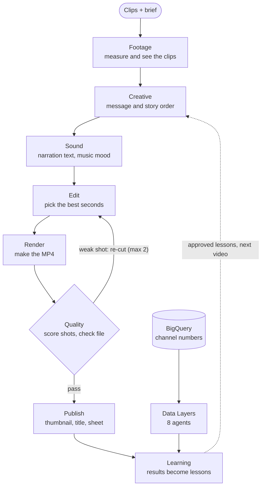

# Alpha Titans

**An AI video editor for LEGO build videos: raw phone footage in, a checked, YouTube-ready video out.**

You upload clips and a short brief. A team of 19 AI agents plans the edit,
picks the best moments, adds captions and music, renders the video and
checks it, sending weak shots back to be re-cut. You download the video, a
thumbnail and a YouTube upload sheet. Nothing is ever posted to YouTube
automatically.

A second team of 8 data agents reads the channel's real YouTube numbers from
BigQuery and turns them into lessons that a person approves before the next
video uses them.

`Python 3.11` · `FastAPI` · `LangGraph` · `ffmpeg` · `Groq` · `Gemini` · `Lyria` · `BigQuery` · `Google Cloud`

---

## How it works



Agents do not call each other. Each one reads what earlier agents wrote to a
shared store, does one job with an AI model or plain code, and writes back its
result and its reason. LangGraph runs them in order, saves progress after
every step (a crash resumes), and handles the re-cut loop. If a model fails,
the agent falls back to a simple rule and marks its result, so a video is
still made.

## The agents

| Team | Agents (built) | Model | Planned |
|---|---|---|---|
| Footage | Clip Analysis, Vision | code, Gemini | Shot Selector |
| Creative | Research, Content Strategy, Story | search API, Groq | Hook |
| Sound | Voiceover, Music | Groq (+ Lyria composes) | Sound Design |
| Edit | Animation, Transition, Caption, Editing Director | Groq (+ Gemini picks the clearest moment) | — |
| Render | Rendering | ffmpeg | Look & Speed, Formats & End Card |
| Quality | Visual Reviewer, Critic | Gemini, code | Features, Calibrator |
| Publish | Thumbnail, Title, Publishing | Groq, code | Drift Watch |
| Learning | Performance, Learning | code | Metrics, Knowledge Base |
| Insight | — | — | Collector, Classifier, Opportunity, Patterns |

**Data Layers** (`server/datalayers/`), with a checker after each step:

| Agent | Does |
|---|---|
| Source Loader | reads `myukti.d_content_analytics.youtube_video_daily` from BigQuery, untouched |
| Cleaner | one row per video per day; every video judged on its first 7 days |
| Enricher | tags each title's hook and topic (Groq) |
| Analytics Builder | one row per video, groups, and the file the Learning agent reads |
| Feature Analyst | measures each published video: length, opening energy, shots |
| Opening Reviewer | Gemini looks at each video's first 2 seconds |
| Pattern Miner | compares groups; keeps only lessons that survive removing each group's best video |
| Why Writer | explains in plain sentences, citing only those lessons |

Feature Analyst and Opening Reviewer need the channel's MP4s in
`data/channel_videos/` (download them from YouTube Studio).

## Run it locally

Requirements: Python 3.9+ (built on 3.11) and ffmpeg with ffprobe on `PATH`
(`winget install Gyan.FFmpeg`).

```bash
python -m venv .venv
.venv\Scripts\activate
pip install -r requirements.txt
copy .env.example .env
run.bat
```

On macOS or Linux use `source .venv/bin/activate`, `cp` and `./run.sh`.

| Page | Address |
|---|---|
| Studio (make a video; Agents screen) | http://127.0.0.1:8000 |
| Mission Control (live team map, Data Layers) | http://127.0.0.1:8000/mission |
| Health check | http://127.0.0.1:8000/api/v2/health |

Data layers from the command line (needs `gcloud auth login` once):
`cd server && python -m datalayers.run`

## Settings (`.env`, never committed)

| Setting | For | Without it |
|---|---|---|
| `AT_LLM_API_KEY`, `AT_LLM_PROVIDER`, `AT_LLM_BASE_URL`, `AT_LLM_MODEL` | text agents (Groq today; Claude with `AT_LLM_PROVIDER=anthropic`) | agents use their rules |
| `AT_VISION_API_KEY`, `AT_VISION_MODEL` | Vision, shot check, Visual Reviewer, Opening Reviewer (Gemini) | those steps are skipped |
| `AT_MUSIC_PROVIDER=lyria`, `AT_MUSIC_PROJECT` | AI-composed music (Google Cloud sign-in, no key) | music composed in code |
| `AT_SEARCH_PROVIDER`, `AT_SEARCH_API_KEY` | Research agent (Tavily or Brave) | Research is skipped |
| BigQuery | Source Loader: signed-in `gcloud` account, or the VM's service account | no fresh numbers |

## Tests

```bash
python -m pytest tests/agents -q
python -m pytest tests/datalayers -q
python -m pytest tests/backend -q
cd server && python -m pytest ../tests/cloud -q
node --test tests/frontend/
```

Run `tests/agents` and `tests/cloud` separately, and keep ffmpeg on `PATH`.

## Where it runs

| Place | Status |
|---|---|
| Local computer | full studio, Mission Control, data layers |
| Cloud studio (Google Cloud) | live: a small always-on machine takes uploads; an 8-CPU machine starts only to make a video, then switches off. About $0.13 per video |
| L4 GPU VM (`myyukti`) | target for daily runs on a timer; waiting for access |

## Status and next steps

- Built: 19 video agents, 8 data agents, live Mission Control, cloud studio.
- Planned: 14 agents (the Insight team, Hook, Sound Design and others).
- Needed: VM access, BigQuery access for the VM, read access to the
  `yt_videos` and `trending` tables, the Anthropic API key, and the channel's
  MP4s for the "why" agents.

## Deployment

The cloud setup lives in [`deploy/cloud/`](deploy/cloud): systemd units for the
control and worker machines, and example settings files
(`control.env.example`, `worker.env.example`). Docker users can run
`docker compose up --build` (ffmpeg is included in the image).

Built by **Akansha**.
